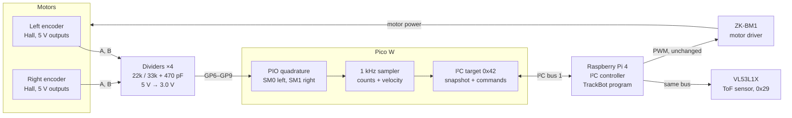

# TrackBot Encoder Interface — Pico W I2C Coprocessor

A Raspberry Pi Pico W acts as an encoder coprocessor for TrackBot. It decodes both drive motors' quadrature encoders in PIO hardware and serves the counts over I²C. A Raspberry Pi 4 (code at https://github.com/grumpy61/trackbot) is the I²C controller and drives a ZK-BM1 motor driver directly.

- **Pico W:** counts every edge of the four encoder signals (A/B per motor), timestamps each snapshot, computes velocity, and answers register reads and command writes at I²C address `0x42`.
- **Pi 4:** polls a 22-byte snapshot at 50–100 Hz on I²C bus 1 (shared with the VL53L1X at `0x29`), turns counts into speed and distance, and runs the control program.
- **Power:** 5 V from the Pi 4 header feeds the Pico's VBUS pin and the encoders' Vcc. Encoder outputs are divided down to about 3.0 V before they reach the Pico.

Target motor: Pololu 34:1 Metal Gearmotor 25D HP 12V with 48 CPR encoder (1632.67 counts per output-shaft revolution).

## Contents

- [System overview](#system-overview)
- [Pin assignments](#pin-assignments)
- [Power](#power)
- [Encoder signal conditioning](#encoder-signal-conditioning)
- [I²C interface](#ic-interface)
- [Firmware (Pico W)](#firmware-pico-w)
- [Pi 4 software](#pi-4-software)
- [Wiring, noise and grounding](#wiring-noise-and-grounding)
- [Bill of materials](#bill-of-materials)
- [Bring-up checklist](#bring-up-checklist)

## System overview



Encoder edges flow left to right into the Pico; only the I²C link and the unchanged PWM path touch the Pi 4. The 5 V rail from the Pi header feeds the Pico (VBUS, via a Schottky diode) and both encoders.

## Pin assignments

The encoders use GP6–GP9 (physical pins 9–12), with ground on pin 13 right beside them. I²C uses GP4/GP5 (pins 6–7), and 5 V enters on VBUS (pin 40).

> **Note:** Each encoder's A and B must sit on **consecutive** GPIOs, A first, because the PIO quadrature program reads a base pin and base + 1.

### Pico W

| Function | Pico GPIO | Pico pin | Connects to |
| --- | --- | --- | --- |
| I²C0 SDA (target) | GP4 | 6 | Pi 4 GPIO2 / SDA1 (header pin 3) |
| I²C0 SCL (target) | GP5 | 7 | Pi 4 GPIO3 / SCL1 (header pin 5) |
| Ground (I²C reference) | GND | 8 | Pi 4 GND (header pin 6) |
| Left encoder A | GP6 | 9 | Left encoder yellow, via divider |
| Left encoder B | GP7 | 10 | Left encoder white, via divider |
| Right encoder A | GP8 | 11 | Right encoder yellow, via divider |
| Right encoder B | GP9 | 12 | Right encoder white, via divider |
| Ground (encoder return) | GND | 13 | Both encoders' green wires; divider and filter grounds |
| Optional reset | RUN | 30 | Pi 4 GPIO24 (header pin 18), driven low only |
| 3.3 V out | 3V3(OUT) | 36 | Not used (spare) |
| 5 V in | VBUS | 40 | Pi 4 5 V (header pin 2 or 4), through a Schottky diode |
| — | VSYS, 3V3_EN | 39, 37 | Leave unconnected |

GP23, GP24, GP25 and GP29 are wired to the Pico W's wireless chip and are not on the header; the design does not touch them. GP0–GP3 and GP10–GP22 remain free.

### Pi 4 header

| Pi 4 pin | Signal | Goes to |
| --- | --- | --- |
| 2 or 4 | 5 V | Pico VBUS (via diode) and the encoders' blue Vcc wires |
| 3 | GPIO2 / SDA1 | Pico GP4, and the VL53L1X SDA (unchanged) |
| 5 | GPIO3 / SCL1 | Pico GP5, and the VL53L1X SCL (unchanged) |
| 6 | GND | Pico GND (pin 8) |
| 18 | GPIO24 (optional) | Pico RUN, to reset the Pico from software |

The Pi already has 1.8 kΩ pull-ups to 3.3 V on GPIO2/3, so add no pull-ups and leave the Pico's internal I²C pull-ups off. For the optional reset line, configure GPIO24 as an input normally and drive it low only to reset; never drive RUN high.

## Power

The Pi 4's 5 V header rail powers everything on this board: the Pico W through VBUS, and both encoders directly. The total load is well under 100 mA, assuming Wi-Fi stays off: the Pico W idles at a few tens of mA, and each Hall encoder draws at most 10 mA.

```
Pi 4 pin 2/4 (+5V) ──┬──|>|── Pico VBUS (pin 40)      SS14 / 1N5817 Schottky, anode at the Pi side
                     │
                     ├──────── Left encoder Vcc (blue)
                     ├──────── Right encoder Vcc (blue)
                     └── 10 µF + 100 nF ── GND         (at the board's 5 V entry)
```

- **Why the diode:** VBUS connects straight to the Pico's USB connector. Without the diode, plugging a USB cable into the Pico for flashing would tie the PC's 5 V directly to the Pi's 5 V rail. With the Schottky in series, the higher source simply wins and neither back-feeds the other. VBUS then sits about 0.3 V low (around 4.7 V), which is fine because the Pico's regulator accepts down to 1.8 V.
- **Why not the Pico's 3.3 V for the encoders:** the Pololu Hall sensor needs at least 3.5 V, so it runs from 5 V. That makes its outputs 5 V, hence the dividers below.
- **Decoupling:** put 10 µF + 100 nF where 5 V enters the board, and another 100 nF at each encoder connector between blue and green.

## Encoder signal conditioning

Each of the four encoder lines gets the same network: a 22 kΩ / 33 kΩ divider (5 V → 3.0 V), plus a 470 pF cap to ground for filtering. The RP2040's input pads have Schmitt triggers enabled by default, which supply the hysteresis.

> **Warning:** The Pico's GPIOs are **not** 5 V tolerant. This network is required, not optional.

```
Encoder A or B ──[22k]──┬──────────┬──> Pico GPIO (GP6 / GP7 / GP8 / GP9)
                        │          │
                      [33k]     [470pF]
                        │          │
                       GND        GND        (to Pico GND pin 13)
```

- **Filter corner:** 22k ∥ 33k ≈ 13.2 kΩ against 470 pF gives τ ≈ 6 µs. The fastest edge spacing at 300 RPM output is about 120 µs (≈ 8,200 counts/s), so real edges pass cleanly while sub-microsecond brush and PWM spikes are rejected.
- **Load on the encoder:** 55 kΩ draws about 0.09 mA, which is negligible. The 3.0 V high level still clears the RP2040's input-high threshold with margin.
- **Unplugged encoder:** the 33 kΩ to ground holds the input low, so a disconnected cable reads as a stopped motor rather than floating noise.
- **Upgrade if needed:** for long cable runs or persistent phantom counts, add a 74LVC14 powered from the Pico's 3V3(OUT). LVC inputs tolerate 5 V, so it can replace the divider. It inverts, but inverting both A and B preserves the quadrature order, so direction is unchanged.

## I²C interface

The Pico is an I²C target at 7-bit address **`0x42`**, on bus 1 at 400 kHz. The Pi reads everything it needs in one 22-byte block read starting at register `0x10`. At 100 Hz that uses about 6% of the bus, leaving plenty for the VL53L1X.

- **Bus speed:** set the following in `/boot/firmware/config.txt` on the Pi (the VL53L1X supports 400 kHz):
  ```
  dtparam=i2c_arm=on,i2c_arm_baudrate=400000
  ```
- **Byte order:** little-endian throughout. The register pointer auto-increments on reads and writes.
- **Transactions:** a read is a write of the register address, then a repeated-start read. A write is the register address followed by its data byte(s).
- **Snapshot latch:** whenever the pointer is set to `0x10`, the Pico copies both counters, both velocities and the timestamp into a frozen buffer in one step, so a block read never mixes old and new values.

### Register map

| Addr | Name | Access | Type | Meaning |
| --- | --- | --- | --- | --- |
| `0x00` | `WHO_AM_I` | R | u8 | Fixed `0xE5`; confirms the Pico is answering |
| `0x01` | `FW_VERSION` | R | u8 | Firmware version |
| `0x02` | `STATUS` | R | u8 | bit0 = data valid; bit1 = Pico restarted by its watchdog since last clear; bit2 = counters zeroed since last read |
| `0x03` | `COMMAND` | W | u8 | `0x01` zero both counts · `0x02` zero left · `0x03` zero right · `0x10` clear STATUS flags · `0xB0` reboot into USB bootloader |
| `0x04` | `CONFIG` | R/W | u8 | bit0 invert left direction; bit1 invert right direction (default `0x00`) |
| `0x05` | `VEL_WINDOW_MS` | R/W | u8 | Velocity averaging window, 10–100 ms (default 20) |
| `0x06` | `PING` | R | u8 | Read counter: each read increments it and returns the new value (first read = 1); wraps 255 → 0, resets at power-up |
| `0x10` | `TIMESTAMP_US` | R | u32 | Pico microsecond clock at the snapshot (wraps every ~71 min) |
| `0x14` | `LEFT_COUNT` | R | i32 | Left position, encoder counts (4× decoding), free-running |
| `0x18` | `RIGHT_COUNT` | R | i32 | Right position, encoder counts, free-running |
| `0x1C` | `LEFT_VEL` | R | i32 | Left velocity, counts/s over `VEL_WINDOW_MS` |
| `0x20` | `RIGHT_VEL` | R | i32 | Right velocity, counts/s |
| `0x24` | `SEQ` | R | u16 | Snapshot counter; increments every latch |

On a tank chassis the two motors face opposite directions, so one side counts negative when driving forward. Set its `CONFIG` invert bit once at startup so both read positive going forward.

> **Clock stretching:** the RP2040 target holds SCL low if it has no byte ready, and the Pi's I²C controller has a long history of mishandling that. The firmware avoids it by keeping the snapshot pre-built so bytes go out from the interrupt handler immediately. If you still see corrupted reads, drop the bus to 100 kHz.

## Firmware (Pico W)

The firmware is built with the Pico C SDK. It has three parts that never block each other: PIO hardware counts edges, a 1 kHz timer turns counts into a snapshot, and an I²C interrupt hands that snapshot to the Pi. Wi-Fi is never initialized.

1. **Quadrature decoding (PIO1, state machines 0 and 1).** Load the `quadrature_encoder.pio` program from the official pico-examples at offset 0 of PIO1. PIO0 is left to the wireless chip driver, which claims a state machine there for the on-board LED. SM0 watches GP6/GP7 (left), SM1 watches GP8/GP9 (right). Counting runs entirely in hardware at thousands of times the encoders' edge rate, with no CPU involvement.
2. **Sampling loop (1 kHz repeating timer).** Read both raw counts, subtract the zero offsets set by `COMMAND`, and apply the `CONFIG` invert bits. Push each count into a small ring buffer, compute velocity over `VEL_WINDOW_MS`, then update a `live` struct (counts, velocities, `time_us_32()` timestamp) under a spin lock.
3. **I²C target (I2C0 on GP4/GP5, `pico_i2c_slave` library).**
   - On a write: the first byte sets the register pointer. If the pointer is `0x10`, copy `live` into `snapshot` and increment `SEQ`. Further bytes are applied to `COMMAND` or `CONFIG` registers.
   - On a read: return bytes from the register image at the pointer and auto-increment. The snapshot is already built, so each byte goes out without delay.
4. **Housekeeping.** Run the hardware watchdog at about 100 ms, fed from the main loop. After a watchdog restart, set `STATUS` bit1 so the Pi knows counts were lost. `COMMAND 0xB0` calls `reset_usb_boot()` for firmware updates over USB.

Zeroing is done with software offsets, not by restarting the PIO, so a zero command never drops an edge that arrives at the same moment.

### Building and flashing

With the Pico SDK installed and `PICO_SDK_PATH` set:

```sh
mkdir build && cd build
cmake -DPICO_BOARD=pico_w ..
make
```

Hold BOOTSEL while plugging in the Pico's USB (or send `COMMAND 0xB0` over I²C), then copy the generated `.uf2` file to the `RPI-RP2` drive that appears.

## Pi 4 software

The TrackBot program adds one reader: a thread that pulls the 22-byte snapshot at a fixed rate and publishes positions and speeds to the rest of the program. Motor control is unchanged.

Install the dependency in the project's virtual environment:

```sh
pip install smbus2
```

```python
import struct, threading, time
from smbus2 import SMBus

ADDR, REG_SNAP, REG_CMD, REG_CFG = 0x42, 0x10, 0x03, 0x04
COUNTS_PER_OUTPUT_REV = 1632.67   # Pololu 34:1 HP + 48 CPR; change for other motors

def d32(new, old):
    # Signed difference of two 32-bit values that may have wrapped
    return ((new - old + 2**31) % 2**32) - 2**31

class EncoderReader(threading.Thread):
    def __init__(self, rate_hz=100, invert=0b01):
        super().__init__(daemon=True)
        self.bus = SMBus(1)
        self.period = 1.0 / rate_hz
        self.bus.write_byte_data(ADDR, REG_CFG, invert)  # bit0 = flip left side
        self.bus.write_byte_data(ADDR, REG_CMD, 0x01)    # zero both counters
        self.left = self.right = 0            # counts
        self.left_rps = self.right_rps = 0.0  # output-shaft rev/s
        self.lock = threading.Lock()

    def run(self):
        while True:
            raw = bytes(self.bus.read_i2c_block_data(ADDR, REG_SNAP, 22))
            t_us, l, r, lv, rv, seq = struct.unpack('<IiiiiH', raw)
            with self.lock:
                self.left, self.right = l, r
                self.left_rps = lv / COUNTS_PER_OUTPUT_REV
                self.right_rps = rv / COUNTS_PER_OUTPUT_REV
            time.sleep(self.period)
```

- **Distance:** multiply output revolutions by the sprocket's effective track travel per revolution. Calibrate it by driving a measured 2 m and dividing by the revolutions counted.
- **Own velocity math:** to compute velocity on the Pi instead, difference the counts with `d32()` and divide by the difference of `TIMESTAMP_US`. Use the Pico's timestamp, not Python's clock, so Linux scheduling jitter drops out.
- **Health check:** read `WHO_AM_I` (`0xE5`) at startup, and watch `SEQ`. If it stops changing or `STATUS` bit1 is set, treat odometry as invalid and re-zero.

## Wiring, noise and grounding

Mount the Pico board within about 30 cm of the Pi so the I²C run stays short, and let the encoder cables take the longer path. I²C is the most noise-sensitive link here; the filtered encoder lines are not.

- **Split the 6-wire encoder lead** right after its header: red/black (motor) go to the ZK-BM1; blue/green/yellow/white (encoder) go to the Pico board. Twist the motor pair and route it away from the encoder wires.
- **Suppress brush noise at the source:** solder a 100 nF ceramic across each motor's terminals.
- **Star ground:** ZK-BM1 motor return, Pi ground and Pico ground meet at one point, at battery negative or the Pi's ground. Motor current must never flow through the wire carrying the encoder and I²C ground reference.
- **Keep I²C away from motor leads,** and run SDA and SCL alongside a ground wire. If both devices on the bus misbehave only while the motors run, the I²C wiring is the first suspect.

## Bill of materials

| Qty | Part | Purpose |
| --- | --- | --- |
| 1 | Raspberry Pi Pico W | Encoder coprocessor |
| 1 | SS14 or 1N5817 Schottky diode | 5 V into VBUS without back-feeding |
| 4 | 22 kΩ resistor | Divider, top |
| 4 | 33 kΩ resistor | Divider, bottom |
| 4 | 470 pF ceramic capacitor | Input filter |
| 3 | 100 nF ceramic capacitor | Board 5 V entry, one per encoder connector |
| 1 | 10 µF capacitor | Board 5 V entry bulk |
| 2 | 100 nF ceramic capacitor | Across each motor's terminals |
| 2 | 1×4 0.1″ header | Encoder connectors (blue, green, yellow, white) |
| 1 | Perfboard or small carrier PCB | Pico, dividers, connectors |

## Bring-up checklist

- [ ] Flash the firmware over USB before wiring VBUS; confirm it runs on USB power alone
- [ ] Fit the Schottky, connect 5 V and GND from the Pi, and measure about 4.7 V on VBUS
- [ ] With an encoder connected, scope or meter each Pico input: about 3.0 V high and 0 V low, never 5 V
- [ ] Run `i2cdetect -y 1` on the Pi and confirm both `0x29` (VL53L1X) and `0x42` (Pico)
- [ ] Read `WHO_AM_I` and get `0xE5`
- [ ] Turn each track by hand and check that counts change, and that `SEQ` increments
- [ ] Drive forward slowly, set the `CONFIG` invert bit so both counts rise, then save it in the startup code
- [ ] Run both motors at full PWM for a few minutes while logging. Check for jumps or reversals in the counts and confirm the VL53L1X still reads cleanly
- [ ] Calibrate track travel per revolution over a measured 2 m run
